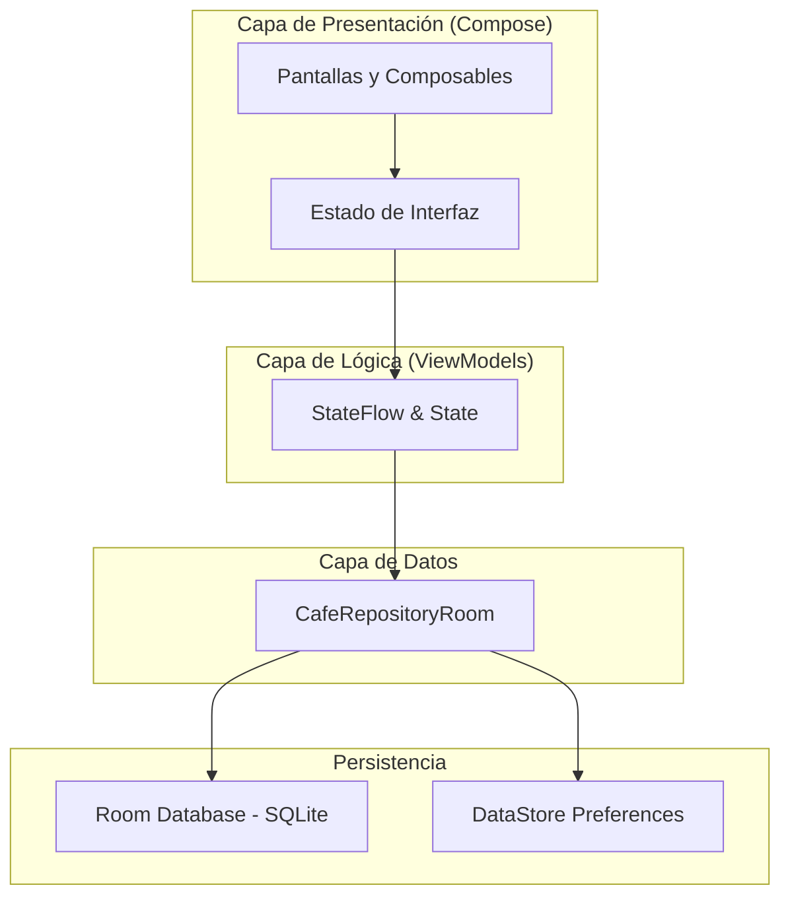

# CafeCampus

CafeCampus es una aplicación móvil nativa desarrollada en Kotlin y Jetpack Compose para la gestión de pedidos de la cafetería universitaria TECSUP.

**Estudiante (Cliente)**: Explora productos por categorías, agrega al carrito, confirma su pedido (hora de recojo y pago) y realiza el seguimiento en tiempo real.
**Administrador**: Revisa el panel de ventas del día, controla la disponibilidad del menú y actualiza los estados de los pedidos.

## Árbol de Paquetes

```text
com.rau.cafecampus/
├── CafeApp.kt
├── MainActivity.kt
├── data/
│   ├── local/
│   │   ├── CafeDatabase.kt
│   │   ├── DatosIniciales.kt
│   │   ├── dao/
│   │   │   ├── PedidoDao.kt
│   │   │   ├── ProductoDao.kt
│   │   │   └── UsuarioDao.kt
│   │   ├── entity/
│   │   │   ├── DetallePedido.kt
│   │   │   ├── Pedido.kt
│   │   │   ├── Producto.kt
│   │   │   └── Usuario.kt
│   │   └── relation/
│   │       └── PedidoConDetalle.kt
│   ├── prefs/
│   │   └── PreferenciasStore.kt
│   └── repository/
│       ├── CafeRepository.kt
│       └── CafeRepositoryRoom.kt
├── model/
│   ├── EstadoPedido.kt
│   ├── ItemCarrito.kt
│   └── Rol.kt
├── ui/
│   ├── admin/
│   │   ├── AjustesScreen.kt
│   │   ├── DetallePedidoAdminScreen.kt
│   │   ├── FormularioProductoScreen.kt
│   │   ├── MenuAdminScreen.kt
│   │   ├── PanelScreen.kt
│   │   └── PedidosAdminScreen.kt
│   ├── cliente/
│   │   ├── ConfirmarPedidoScreen.kt
│   │   ├── DetalleProductoScreen.kt
│   │   ├── LoginScreen.kt
│   │   ├── MenuScreen.kt
│   │   ├── MisPedidosScreen.kt
│   │   ├── SeguimientoScreen.kt
│   │   └── SplashScreen.kt
│   ├── components/
│   │   ├── AppTopBar.kt
│   │   ├── CafeButton.kt
│   │   ├── CafeTextField.kt
│   │   ├── EstadoChip.kt
│   │   ├── PedidoCard.kt
│   │   ├── ProductoCard.kt
│   │   ├── ProductoIcono.kt
│   │   └── StepperEstado.kt
│   ├── navigation/
│   │   ├── NavCafe.kt
│   │   └── Rutas.kt
│   └── theme/
│       ├── Color.kt
│       ├── Theme.kt
│       └── Type.kt
└── viewmodel/
    ├── CafeViewModelFactory.kt
    ├── MenuAdminViewModel.kt
    ├── MenuViewModel.kt
    ├── PanelAdminViewModel.kt
    ├── PedidosAdminViewModel.kt
    ├── PedidosClienteViewModel.kt
    └── SesionViewModel.kt
```

---

## 🏛️ Diagrama de Arquitectura (MVVM)



## Capturas de Pantalla

### Perfil Estudiante
1. **Inicio de Sesión**:

2. **Menú de Productos**:

3. **Seguimiento de Pedido**:


### Perfil Administrador 
1. **Panel de Control**:

2. **Gestión de Pedidos**:

3. **Detalle del Pedido**:

## Sección Para pensar

1. **¿Por qué guardar precio y nombre en `DetallePedido` y no solo el ID del producto?**
Para preservar el precio histórico cobrado. Si el administrador cambia el precio de un producto mañana, los pedidos anteriores mantienen intacto el cobro original.

2. **¿Diferencia entre Room y DataStore?**
Room guarda tablas y relaciones complejas (usuarios, productos, pedidos). **DataStore** guarda preferencias pequeñas clave-valor (sesión activa, rol, modo oscuro).

3. **¿Por qué la UI no accede directamente a los DAO o Repositorio?**
Para cumplir la arquitectura MVVM. La UI solo observa el `StateFlow` del ViewModel, aislando la vista de la base de datos y evitando acoplamiento.

4. **¿Por qué usar `Flow` y `StateFlow`?**
Room emite cambios en tiempo real con `Flow`, y `StateFlow` recompone la interfaz de Compose automáticamente sin recargar manualmente.

