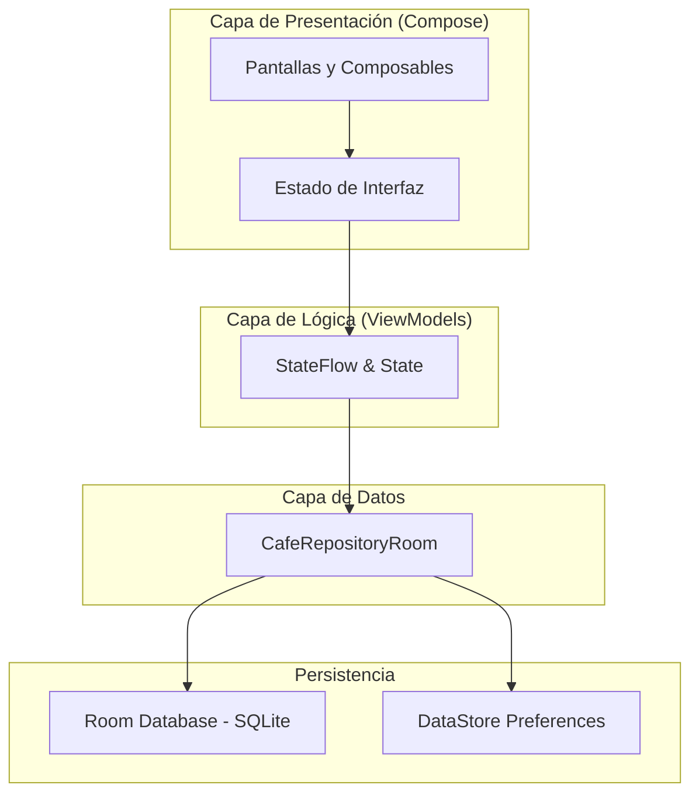
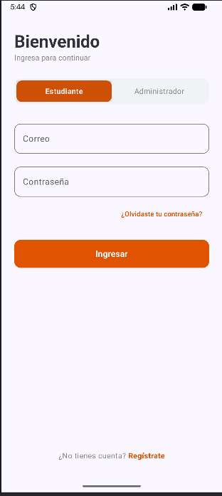
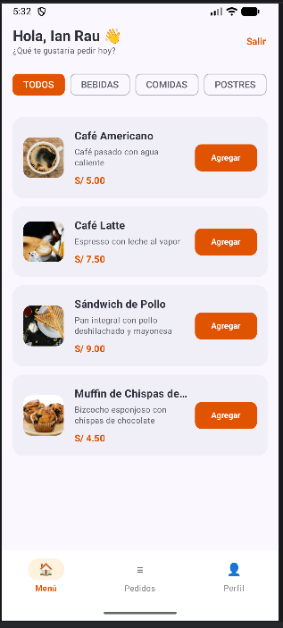
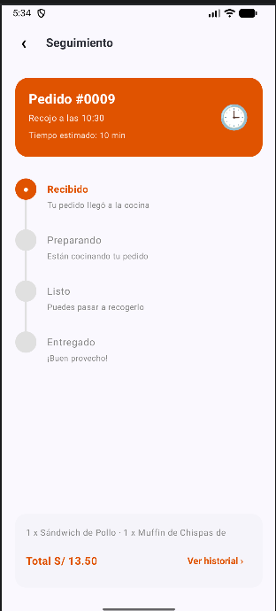
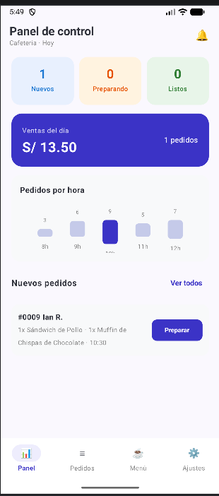
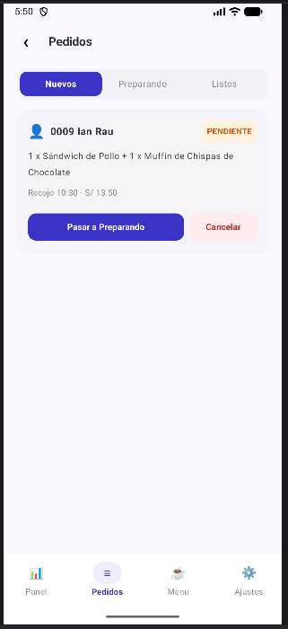
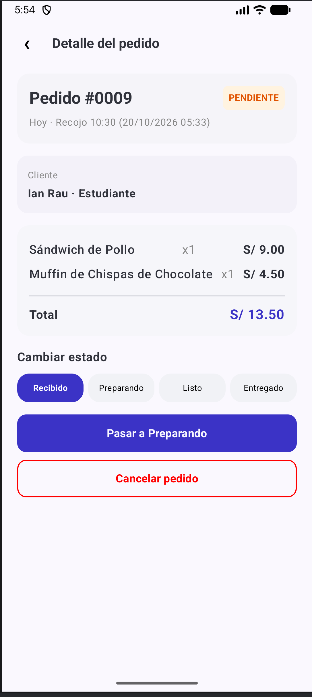

# CafeCampus

Nombre: Ian Alexander Rau Reyes

CafeCampus es una aplicación móvil nativa desarrollada en Kotlin y Jetpack Compose para la gestión de pedidos de la cafetería universitaria TECSUP,
se divide en Estudiante y Administrador. 

**Estudiante**: Explora productos por categorías, agrega al carrito, confirma su pedido (hora de recojo y pago) y realiza el seguimiento en tiempo real

**Administrador**: Revisa el panel de ventas del día, controla la disponibilidad del menú y actualiza los estados de los pedidos.

## Árbol de Paquetes

```text
com.rau.cafecampus/
├── CafeApp.kt
├── MainActivity.kt
├── data/
│   ├── local/
│   │   ├── CafeDatabase.kt
│   │   ├── DatosIniciales.kt
│   │   ├── dao/
│   │   │   ├── PedidoDao.kt
│   │   │   ├── ProductoDao.kt
│   │   │   └── UsuarioDao.kt
│   │   ├── entity/
│   │   │   ├── DetallePedido.kt
│   │   │   ├── Pedido.kt
│   │   │   ├── Producto.kt
│   │   │   └── Usuario.kt
│   │   └── relation/
│   │       └── PedidoConDetalle.kt
│   ├── prefs/
│   │   └── PreferenciasStore.kt
│   └── repository/
│       ├── CafeRepository.kt
│       └── CafeRepositoryRoom.kt
├── model/
│   ├── EstadoPedido.kt
│   ├── ItemCarrito.kt
│   └── Rol.kt
├── ui/
│   ├── admin/
│   │   ├── AjustesScreen.kt
│   │   ├── DetallePedidoAdminScreen.kt
│   │   ├── FormularioProductoScreen.kt
│   │   ├── MenuAdminScreen.kt
│   │   ├── PanelScreen.kt
│   │   └── PedidosAdminScreen.kt
│   ├── cliente/
│   │   ├── ConfirmarPedidoScreen.kt
│   │   ├── DetalleProductoScreen.kt
│   │   ├── LoginScreen.kt
│   │   ├── MenuScreen.kt
│   │   ├── MisPedidosScreen.kt
│   │   ├── SeguimientoScreen.kt
│   │   └── SplashScreen.kt
│   ├── components/
│   │   ├── AppTopBar.kt
│   │   ├── CafeButton.kt
│   │   ├── CafeTextField.kt
│   │   ├── EstadoChip.kt
│   │   ├── PedidoCard.kt
│   │   ├── ProductoCard.kt
│   │   ├── ProductoIcono.kt
│   │   └── StepperEstado.kt
│   ├── navigation/
│   │   ├── NavCafe.kt
│   │   └── Rutas.kt
│   └── theme/
│       ├── Color.kt
│       ├── Theme.kt
│       └── Type.kt
└── viewmodel/
    ├── CafeViewModelFactory.kt
    ├── MenuAdminViewModel.kt
    ├── MenuViewModel.kt
    ├── PanelAdminViewModel.kt
    ├── PedidosAdminViewModel.kt
    ├── PedidosClienteViewModel.kt
    └── SesionViewModel.kt
```

---

## Diagrama de Arquitectura (MVVM)



## Capturas de Pantalla

### Perfil Estudiante

1. **Inicio de Sesión**: `LoginScreen.kt` - Selector de rol y campos de ingreso.



2. **Menú de Productos**: `MenuScreen.kt` - Lista filtrable con saludo "Hola, Ian Rau 👋".



3. **Seguimiento de Pedido**: `SeguimientoScreen.kt` - Línea de tiempo vertical de estado.



### Perfil Administrador

1. **Panel de Control**: `PanelScreen.kt` - Métricas de ventas en Soles y gráfico por hora.



2. **Gestión de Pedidos**: `PedidosAdminScreen.kt` - Lista con filtros y botones morados de estado.



3. **Detalle del Pedido**: `DetallePedidoAdminScreen.kt` - Ficha de cliente, productos y cambio de estado.



## Sección Para pensar

1. **¿Por qué el Repository es una interface?**
Para desacoplar la UI de la base de datos. Permite cambiar la fuente de datos (ej. pasar a un servidor) sin modificar los ViewModels ni las pantallas.

2. **¿Por qué crearPedido es suspend y observarPedidosCliente es Flow?**
crearPedido es una acción puntual de un solo paso (suspend), mientras que observarPedidosCliente es un flujo reactivo que actualiza la pantalla continuamente en tiempo real (Flow).

3. **¿Qué pasaría si dos perfiles usaran bases de datos distintas?**
Se perdería la sincronización en tiempo real. El administrador no vería los pedidos realizados por el estudiante ni podría cambiar sus estados.

4. **¿Qué debería cambiar si mañana los datos viven en un servidor?**
Solo la implementación del repositorio (usando Retrofit/Ktor). Los ViewModels y las pantallas no cambian porque dependen de la interfaz CafeRepository.
