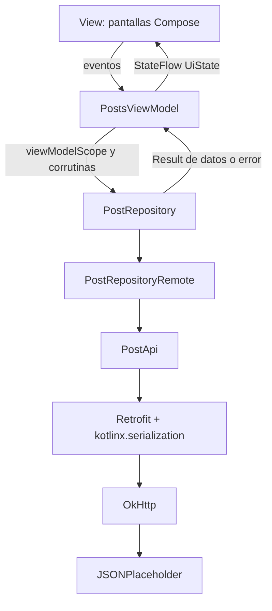
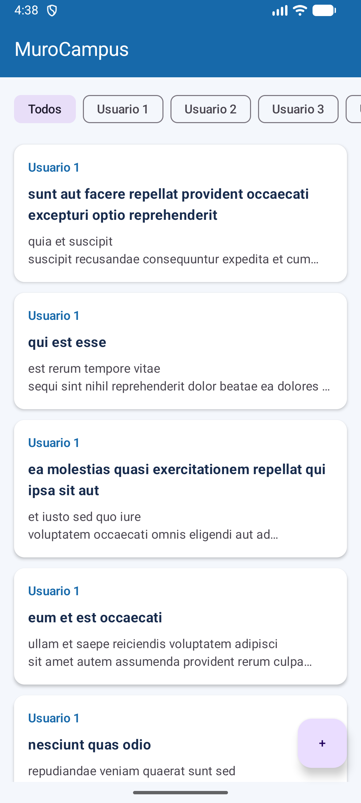
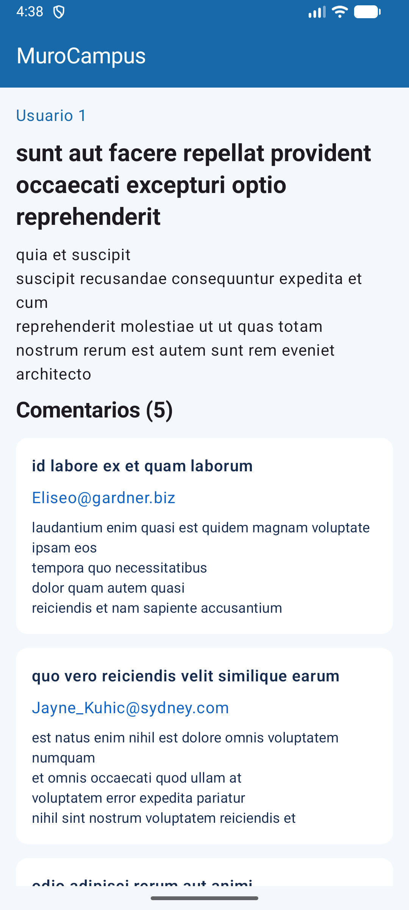
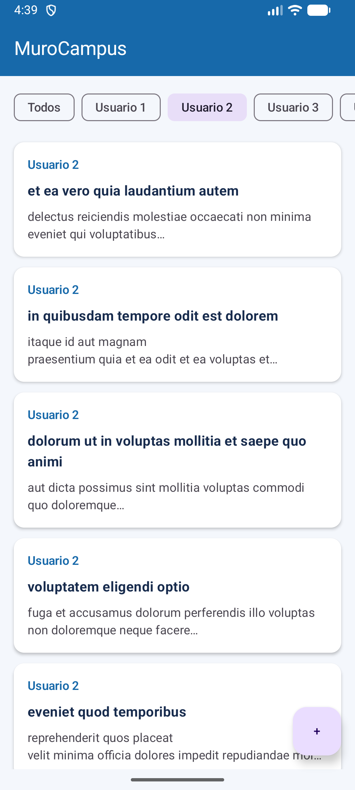
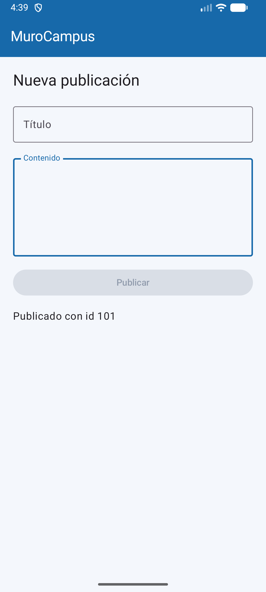
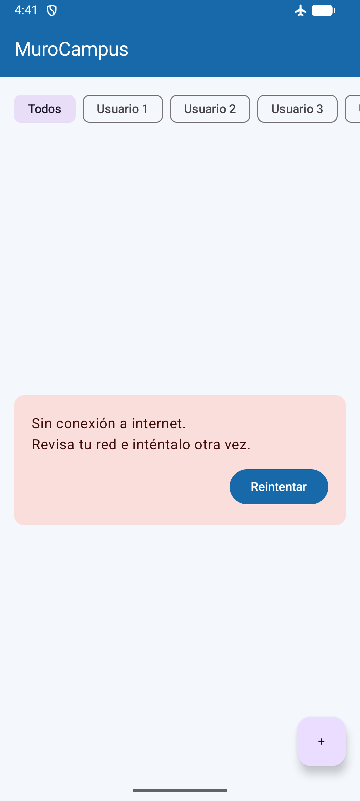

# MuroCampus

Aplicación Android en Kotlin y Jetpack Compose para leer publicaciones de JSONPlaceholder, abrir sus comentarios, filtrar publicaciones por usuario y simular la creación de una publicación.

## Requisitos

- Android Studio con JDK 21 y Android SDK 37.
- Emulador o dispositivo Android 7.0 (API 24) o superior.
- Conexión a Internet para las operaciones de JSONPlaceholder.

## Ejecutar

1. Abre `Semana09/MuroCampus` en Android Studio y sincroniza Gradle.
2. Ejecuta la configuración `app` en un emulador con Internet.
3. Para compilar desde la terminal:

   ```powershell
   .\gradlew.bat assembleDebug
   ```

El APK de depuración se genera en `app/build/outputs/apk/debug/app-debug.apk`.

## Paquetes

```text
com.tecsup.murocampus/
├── MainActivity.kt
├── model/
│   └── Modelos.kt
├── data/
│   ├── PostRepository.kt
│   └── remote/
│       ├── PostApi.kt
│       └── RetrofitClient.kt
├── viewmodel/
│   ├── PostsViewModel.kt
│   ├── PostsViewModelFactory.kt
│   └── UiState.kt
└── ui/
    ├── Componentes.kt
    ├── PantallaLista.kt
    ├── PantallaDetalle.kt
    ├── PantallaCrear.kt
    └── theme/
        └── Theme.kt
```

## Arquitectura MVVM + Repository



La UI solo observa `StateFlow` y envía eventos al ViewModel. El ViewModel conoce únicamente `PostRepository`; el Repository convierte fallos HTTP, de serialización o de conectividad en `Result`. Las cancelaciones se vuelven a lanzar. `UiState` representa carga, éxito o error y la pantalla los muestra con `when`.

## Capturas

Las imágenes se capturaron ejecutando la aplicación de `main` en el emulador Android API 37.

| Lista | Detalle y comentarios | Filtro por usuario |
|---|---|---|
|  |  |  |

| Crear publicación y respuesta | Error sin conexión |
|---|---|
|  |  |

## Verificaciones ejecutadas

| Verificación | Resultado |
|---|---|
| `assembleDebug` | Correcto en el proyecto final. |
| Carga inicial | La API devolvió 100 publicaciones. |
| Detalle de publicación 1 | Se mostraron cinco comentarios. |
| Filtro Usuario 2 | Se mostraron diez publicaciones y Logcat registró `posts?userId=2`. |
| Crear publicación | JSONPlaceholder respondió HTTP 201 con `id = 101`; la publicación no se persiste en el servicio. |
| Sin conexión | Se mostró el mensaje de error y el botón Reintentar. |
| Reintentar | Tras restablecer la red, la lista volvió a responder HTTP 200. |
| Código del ViewModel | No importa Retrofit, `PostApi` ni `HttpException`. |

## Para pensar

### 1. ¿Qué diferencia hay entre GET y POST? ¿Por qué crear lleva `@Body` y `porUsuario` lleva `@Query`?

GET recupera una representación del servidor y expresa el recurso en la URL. POST envía datos para crear un recurso; por eso `crear` serializa `NuevoPost` en el cuerpo HTTP con `@Body`. El filtro no crea ni modifica un recurso: añade el parámetro `userId` a `GET posts?userId=2`, que Retrofit representa con `@Query`.

### 2. ¿Por qué la ruta es `posts` y no `/posts`?

La URL base termina en `/` y Retrofit combina con ella las rutas relativas. Una ruta que empieza con `/` se interpreta como ruta absoluta desde la raíz del host y puede descartar segmentos de la URL base. `posts` conserva la combinación esperada con `https://jsonplaceholder.typicode.com/`.

### 3. ¿Por qué el Repository devuelve `Result` en vez de dejar que la excepción llegue al ViewModel?

El Repository es la frontera de datos: encapsula errores de red y HTTP en `Result.failure` y retorna valores exitosos mediante `Result.success`. El ViewModel decide cómo convertir el resultado en `UiState` sin depender de Retrofit ni de tipos HTTP. `CancellationException` se relanza para que cancelar una corrutina siga funcionando correctamente.

### 4. ¿Qué pasa si olvidas el permiso `INTERNET`? ¿Y si olvidas `ignoreUnknownKeys` y el servidor agrega un campo nuevo?

Sin `android.permission.INTERNET`, Android bloquea las conexiones de red aunque la app compile. Sin `ignoreUnknownKeys`, kotlinx.serialization rechaza un objeto JSON que contenga claves desconocidas y lanza `SerializationException`; con la opción activada, ignora esas claves y decodifica las propiedades conocidas.

### 5. ¿Por qué la pantalla de lista usa un `when` sobre `UiState` y no un `if` con tres variables?

`UiState` modela estados excluyentes: la lista está cargando, tiene datos o tiene un error. El `when` obliga a renderizar cada caso y evita combinaciones contradictorias, como mostrar simultáneamente un indicador de carga y un error con datos viejos.

### 6. JSONPlaceholder no guarda los POST. ¿Cómo cambiaría tu app si usaras un servicio real?

La app mostraría la respuesta del servidor, pero al volver a cargar la lista el recurso creado podría no aparecer porque JSONPlaceholder solo simula el alta. Con un backend real, el Repository actualizaría su fuente local o volvería a consultar la lista, gestionaría la identidad/autenticación si aplica y trataría validaciones, errores y persistencia reales. No se debería asumir que el ID es 101: se usa el ID que devuelva el servicio.

## Alcance del servicio

JSONPlaceholder es un servicio de práctica. Sus operaciones POST y DELETE simulan cambios y no persisten el estado. La implementación y sus evidencias se hicieron con asistencia de IA por solicitud del propietario del repositorio; el PDF asigna formalmente la Fase 1 a trabajo sin IA, así que esta copia no debe describirse como trabajo realizado sin IA.
