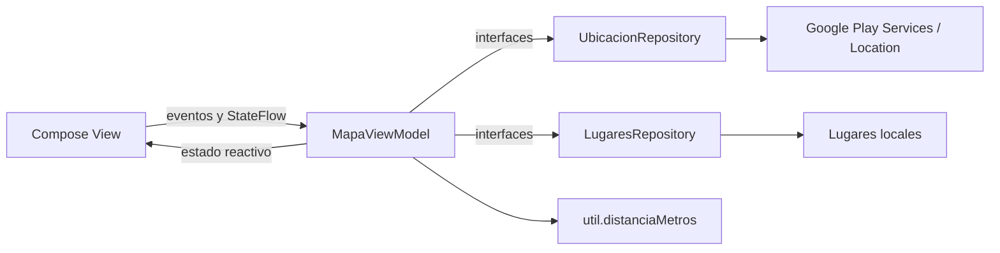

# CampusGPS

Aplicación Android para mostrar la ubicación actual y explorar cinco lugares del campus, ordenados por distancia. Está implementada con Kotlin, Jetpack Compose, Material 3 y arquitectura MVVM + Repository.

## Configuración

1. Abre `Semana13/CampusGps` en Android Studio.
2. Añade tu clave de Google Maps SDK for Android a `local.properties` como `MAPS_API_KEY=...`. El archivo está excluido de Git.
3. Habilita Maps SDK for Android para esa clave y limita la clave a la aplicación.
4. Ejecuta la app en un dispositivo/emulador con Google Play Services y ubicación habilitada.

La clave local de este entorno está vacía; por eso las pruebas visuales de mapa y las capturas deben completarse con una clave habilitada y un emulador/dispositivo. No se incluyen capturas simuladas.

## Estructura de paquetes

```text
app/src/main/java/com/tecsup/campusgps/
├── MainActivity.kt
├── data/
│   ├── LugaresRepository.kt
│   ├── LugaresRepositoryLocal.kt
│   ├── UbicacionRepository.kt
│   └── UbicacionRepositoryGoogle.kt
├── model/
│   └── Modelos.kt
├── ui/
│   ├── ListaLugares.kt
│   ├── MapaUbicacion.kt
│   ├── MensajeError.kt
│   ├── PantallaMapa.kt
│   └── theme/
├── util/
│   └── Distancia.kt
└── viewmodel/
    ├── CampusViewModelFactory.kt
    └── MapaViewModel.kt
```

## Arquitectura



La interfaz presenta estados y envía acciones al ViewModel. El ViewModel conserva la lógica de la presentación, solicita información mediante interfaces y publica StateFlows. Los repositorios concentran los accesos externos. El cálculo de distancia está fuera de los Composables.

## Capturas requeridas

Guarda aquí capturas reales del emulador/dispositivo y actualiza estos enlaces. No se han marcado como completadas porque no hay una clave de Maps disponible en el entorno para validar la representación del mapa.

| Evidencia | Archivo |
|---|---|
| Diálogo de permiso | `capturas/01-permiso.png` |
| Mapa con ubicación actual | `capturas/02-ubicacion.png` |
| Marcadores del campus | `capturas/03-marcadores.png` |
| Lista ordenada por distancia | `capturas/04-lista-ordenada.png` |
| Mensaje de error | `capturas/05-error.png` |

## Pruebas de aceptación del laboratorio

Compilación verificada con `./gradlew assembleDebug`. Las comprobaciones siguientes requieren ejecución manual en un emulador/dispositivo; no se consideran aprobadas por una compilación satisfactoria.

- [ ] Primera apertura y solicitud de permiso.
- [ ] Permiso concedido: coordenadas y marcador «Estás aquí».
- [ ] Permiso denegado: mensaje y acceso a ajustes, sin cierre inesperado.
- [ ] Cinco marcadores y detalles de nombre/categoría.
- [ ] Lista ordenada, distancias en m o km, selección y navegación de cámara.
- [ ] El lugar más cercano se resalta en verde y el botón se deshabilita antes de buscar.
- [ ] Nueva búsqueda actualiza distancias, orden y lugar más cercano.
- [ ] GPS apagado: mensaje y acción «Reintentar».
- [ ] Rotación conserva ubicación y lista.
- [ ] `local.properties` no está versionado y la clave no aparece en el repositorio.

## Para pensar

1. **¿Por qué `FusedLocationProviderClient` está en el Repository y no en el ViewModel?** El cliente pertenece a Google Play Services y es una dependencia externa. El Repository lo encapsula detrás de una interfaz; así el ViewModel no conoce SDKs ni necesita `Context`, y puede probarse con un repositorio sustituto.
2. **¿Qué diferencia hay entre el permiso de ubicación y la clave de Maps? ¿Qué ocurre si falta cada uno?** El permiso es autorización del usuario para que la app obtenga su ubicación. Si falta, no se puede leer la posición. La clave identifica y autoriza el uso de Maps SDK; si falta o no es válida, el mapa no carga correctamente aunque la app pueda obtener ubicación.
3. **¿Por qué va la clave en `local.properties`? ¿Qué hacer si se sube a GitHub?** Mantenerla fuera de los archivos versionados reduce la exposición accidental. Si se publica, hay que revocarla/rotarla en Google Cloud, revisar su uso y restricciones, y limpiar el secreto del historial cuando corresponda.
4. **¿Dónde se calcula la distancia y por qué no en el Composable?** En la capa de lógica del ViewModel mediante una función de `util`, usando las coordenadas del modelo. El Composable solo presenta resultados; separar el cálculo facilita reutilización y pruebas, y evita lógica de negocio ligada a recomposiciones.
5. **¿Qué ocurre si se niega el permiso dos veces y cómo se maneja?** Android puede dejar de mostrar el diálogo después de rechazos repetidos. La app debe tratar la falta de permiso como un estado de error, evitar solicitar ubicación sin autorización y ofrecer acceso a los ajustes para concederla manualmente.
