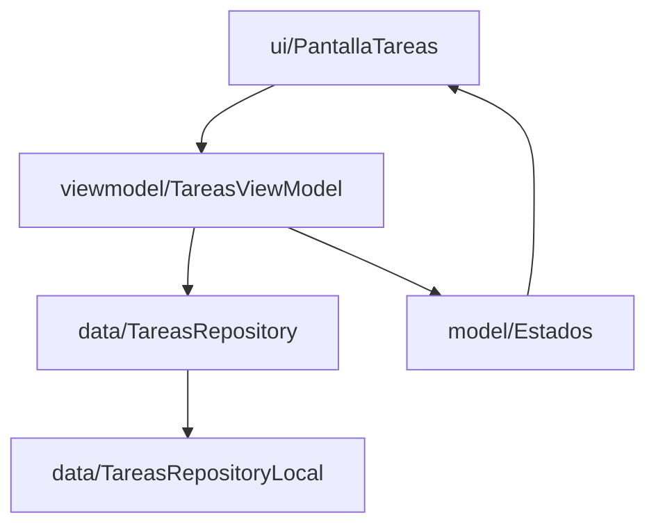

# CentroTareas

Aplicación Android de laboratorio para mostrar cómo ejecutar tareas prolongadas sin bloquear la interfaz. Está desarrollada con Kotlin, Jetpack Compose, Material 3, corrutinas, ViewModel y Repository.

## Arquitectura



La UI observa `StateFlow` y comunica eventos al ViewModel. El ViewModel conserva el estado durante cambios de configuración y delega el cálculo y las cargas al contrato del Repository. El Repository no conoce Compose ni la UI.

## Estructura de paquetes

```text
com.rau.centrotareas/
├── MainActivity.kt
├── model/
│   └── Estados.kt
├── data/
│   ├── TareasRepository.kt
│   └── TareasRepositoryLocal.kt
├── viewmodel/
│   ├── TareasViewModel.kt
│   └── TareasViewModelFactory.kt
└── ui/
    ├── PantallaTareas.kt
    └── theme/
```

## Funciones

- Tarea con progreso de 0 a 100 %, indicador de respuesta y cancelación con `Job`.
- Conteo cancelable de primos en `Dispatchers.Default`.
- Cargas ficticias del perfil de Ana Torres y los pedidos 101, 102 y 103: secuencial (aprox. 5 s) o paralela (aprox. 3 s).
- Interruptor de error simulado, mensaje de error y reintento en paralelo.
- Todos los datos de ejemplo son locales; no se solicitan permisos ni conexión de red.

## Compilar

Abre `Semana14/CentroTareas` en Android Studio o ejecuta desde la raíz del repositorio:

```powershell
Semana14\CentroTareas\gradlew.bat -p Semana14\CentroTareas assembleDebug
```

La compilación `assembleDebug` se completó correctamente durante esta entrega.

## Observación del Paso 1

Al ejecutar `Thread.sleep(4000)` desde el hilo principal, la pantalla deja de responder durante cuatro segundos. El valor de `Trabajando...` no alcanza a dibujarse porque el hilo principal queda ocupado antes de completar el siguiente frame. Con diez segundos, Android puede mostrar el diálogo de “La aplicación no responde” (ANR), y el usuario puede cerrarla.

La implementación final reemplaza esa espera por `viewModelScope`, `delay` y `withContext(Dispatchers.Default)`. No contiene `Thread.sleep`, `GlobalScope` ni `runBlocking` en el código Kotlin de la app.

## Respuestas para pensar

1. **¿Por qué no se veía `Trabajando...` en el Paso 1?** El cambio de estado ocurría antes de bloquear el hilo, pero Android no podía dibujar el nuevo frame hasta que terminara `Thread.sleep`.
2. **¿Qué diferencia hay entre `Thread.sleep` y `delay`?** `Thread.sleep` bloquea el hilo que lo ejecuta. `delay` suspende la corrutina y libera el hilo para otras tareas.
3. **¿Por qué `Dispatchers.Default` para primos y `Dispatchers.IO` para la red?** El conteo de primos usa CPU; `Default` está pensado para trabajo intensivo de CPU. La red y el disco esperan I/O y normalmente usan `IO`. Las cargas de este laboratorio simulan espera con `delay`, que no bloquea un hilo.
4. **¿Qué pasa al cerrar la pantalla y qué papel cumple `viewModelScope`?** Al destruirse definitivamente el ViewModel, `viewModelScope` cancela sus corrutinas hijas. En una rotación el ViewModel se conserva y el trabajo continúa.
5. **¿Por qué `async` tarda unos 3 s y no 5 s? ¿Qué pasa si falla una carga?** Ambas esperas comienzan juntas, por lo que el tiempo queda limitado por la más lenta (3 s). `coroutineScope` cancela la otra operación si una falla; el ViewModel captura el error y conserva la pantalla abierta para reintentar.

## Capturas de aceptación

El PDF solicita cinco capturas de la aplicación: progreso (o congelamiento), cancelación, resultado de primos, comparación de cargas y error. En este entorno no fue posible iniciar el AVD: el emulador x86_64 informó que requiere aceleración de hardware y la ejecución sin aceleración no apareció como dispositivo en `adb`. Por eso no se incluyen imágenes inventadas ni capturas de referencia rotuladas como resultados de esta app.

| Estado que debe capturarse | Archivo sugerido | Estado |
|---|---|---|
| Tarea con progreso | `capturas/01-progreso.png` | Pendiente de ejecutar el AVD |
| Tarea cancelada | `capturas/02-cancelada.png` | Pendiente de ejecutar el AVD |
| Conteo de primos | `capturas/03-primos.png` | Pendiente de ejecutar el AVD |
| Cargas secuencial y paralela | `capturas/04-cargas.png` | Pendiente de ejecutar el AVD |
| Error y reintento | `capturas/05-error.png` | Pendiente de ejecutar el AVD |

## Pruebas de aceptación manuales

Con un emulador Android operativo, comprobar: toques mientras corre la tarea, progreso completo, cancelación y nuevo inicio, 168 primos hasta 1000, cálculo de un N grande sin congelamiento, duraciones de 5 s/3 s, error seguido de reintento con el interruptor desactivado y persistencia del progreso durante una rotación. La compilación fue verificada; estas comprobaciones visuales e interactivas requieren iniciar la app en un emulador.
