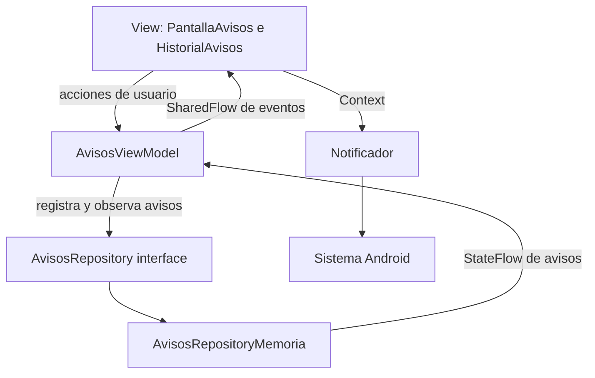
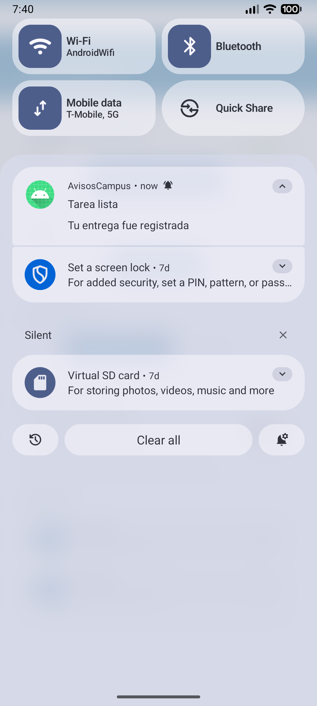
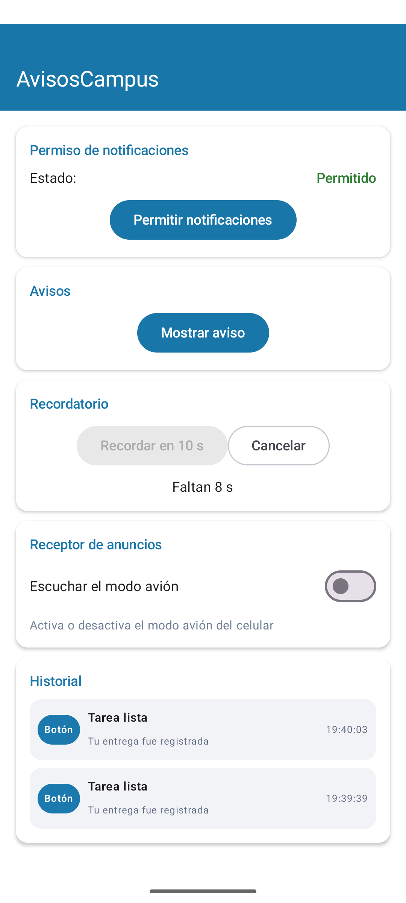
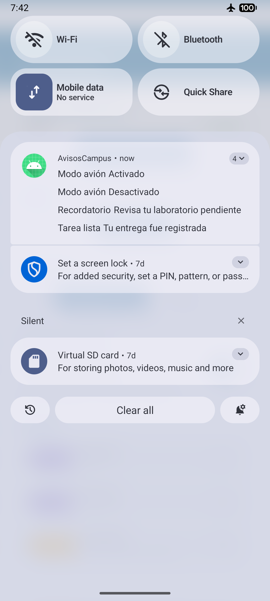
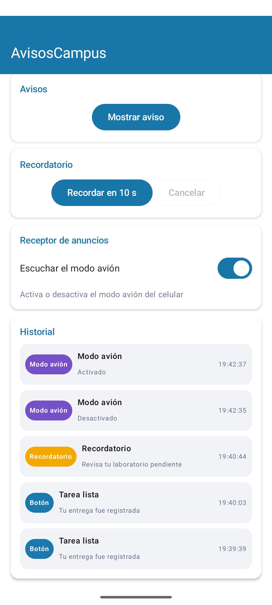
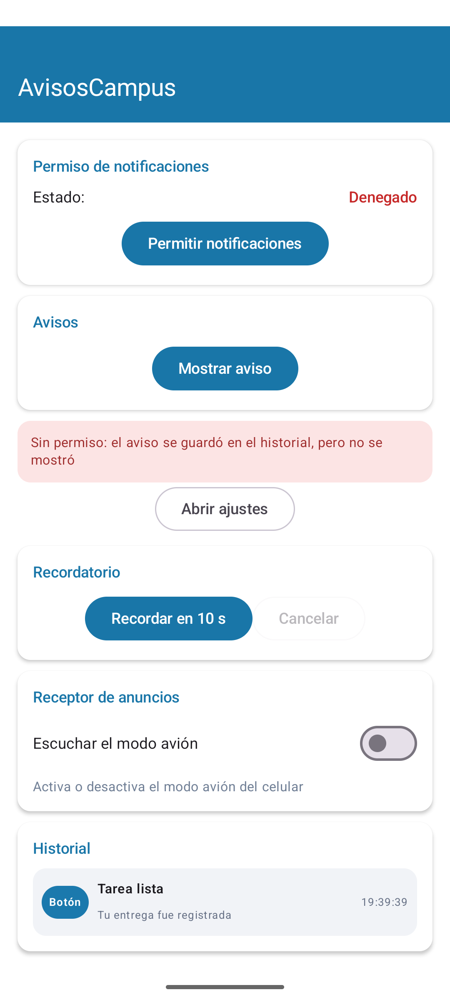

# AvisosCampus

Aplicación Android que muestra notificaciones locales, programa recordatorios, escucha cambios del modo avión y guarda los avisos en un historial en memoria.

## Árbol de paquetes

```text
com.rau.avisoscampus/
├── AvisosApp.kt
├── MainActivity.kt
├── data/
│   └── AvisosRepository.kt
├── model/
│   └── Modelos.kt
├── notificacion/
│   └── Notificador.kt
├── receiver/
│   └── ModoAvionReceiver.kt
├── ui/
│   ├── HistorialAvisos.kt
│   ├── PantallaAvisos.kt
│   └── theme/
│       ├── Color.kt
│       ├── Theme.kt
│       └── Type.kt
└── viewmodel/
    ├── AvisosViewModel.kt
    └── AvisosViewModelFactory.kt
```

## Diagrama MVVM



## Capturas

### Notificación en el panel



### Recordatorio



### Modo avión



### Historial



### Permiso denegado



## Para pensar

1. **¿Por qué una notificación necesita un canal y un permiso? ¿Qué pasa si falta cada uno?**  
   El canal permite configurar las notificaciones en Android 8 o superior; sin él, el sistema no las muestra. En Android 13 o superior se requiere `POST_NOTIFICATIONS`; sin permiso, la notificación no se presenta.

2. **¿Por qué el ViewModel emite un evento y no muestra la notificación él mismo?**  
   El ViewModel no debe depender de `Context` ni del sistema Android. La pantalla recibe el evento y llama al notificador, manteniendo separadas la lógica de presentación y la de la app.

3. **¿Qué pasa si usas el mismo id en dos notificaciones?**  
   La segunda notificación reemplaza a la primera con ese mismo id.

4. **¿Por qué `onReceive` debe ser corto y por qué hay que quitar el receptor al salir?**  
   `onReceive` corre en el hilo principal y debe terminar rápido para no bloquear la app. Quitar el receptor al salir evita fugas de memoria y avisos duplicados.

5. **¿En qué casos usarías una notificación local y en cuáles una push de Firebase?**  
   Usaría una notificación local para recordatorios y eventos que genera el propio dispositivo. Usaría Firebase Cloud Messaging para avisos remotos enviados por un servidor, incluso si la app no está abierta.
